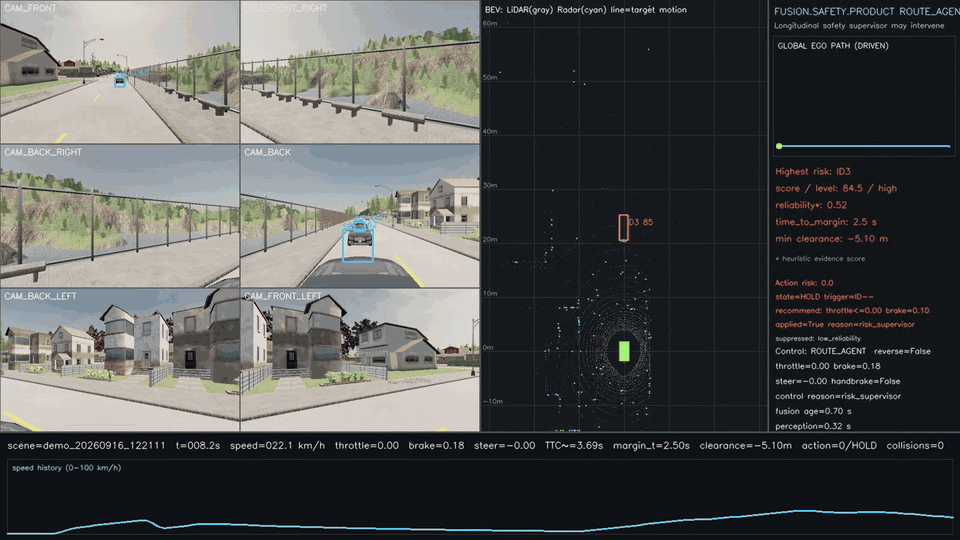
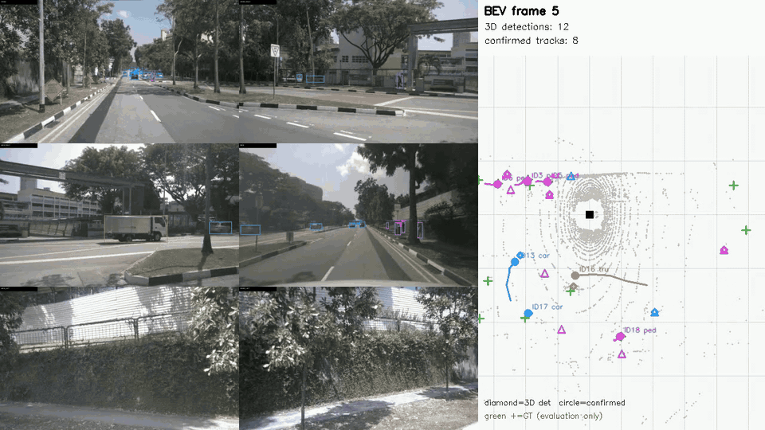

# Fusion Safety Agent

Fusion Safety Agent 面向 CARLA 仿真中的多传感器感知与纵向安全控制。系统接收连续的相机、
LiDAR、Radar 观测及本车状态，更新周围目标的三维轨迹和短时预测，并计算碰撞风险。
它支持**手动驾驶监测**、**自动路线闭环运行**和**标准场景回归评测**；Active 模式可限制油门并施加制动。

MMDetection3D BEVFusion 提供相机与 LiDAR 融合的三维检测结果。项目在检测结果上实现了
Radar 径向速度关联、跨帧跟踪、轨迹及不确定性预测、风险判定和纵向控制仲裁。
传感器健康状态与感知数据时效性参与控制门控。在线风险决策使用传感器数据、本车状态和路线；
周边车辆的 CARLA actor 状态与三维真值框留在场景构建和评测环节。

## 演示

页面内提供两段视频预览；点击画面可观看或下载完整的 H.264 视频。

### CARLA 自动路线运行：纵向安全介入

[](https://github.com/QinghuiRen/fusion-safety-agent/releases/download/v1.0.1/carla_active_safety_dashboard.mp4)

这段 35 秒的 CARLA 自动路线演示记录了前车风险触发制动、停车保持及恢复行驶。
画面左侧是六相机检测结果，中间的 BEV 显示 LiDAR/Radar 回波、Track ID 和目标运动，
右侧显示风险、证据可靠度与控制状态；底部记录车速、TTC、预计安全间距和控制动作。
[完整视频（MP4）](https://github.com/QinghuiRen/fusion-safety-agent/releases/download/v1.0.1/carla_active_safety_dashboard.mp4)

### nuScenes：六相机与 BEV 连续跟踪

[](https://github.com/QinghuiRen/fusion-safety-agent/releases/download/v1.0.1/nuscenes_multisensor_tracking.mp4)

nuScenes 离线序列展示六相机检测、点云俯视图、跨帧目标 ID 与运动轨迹，
用于查看感知和跟踪结果。[完整视频（MP4）](https://github.com/QinghuiRen/fusion-safety-agent/releases/download/v1.0.1/nuscenes_multisensor_tracking.mp4)

## 应用场景

| 场景 | 模块行为 | 可观察结果 |
| --- | --- | --- |
| 手动驾驶 | 保留键盘驾驶；安全监督器可选 Shadow 或 Active | 六相机仪表盘、BEV、风险与控制日志 |
| 自动路线 | 路线 Agent 驾驶；Active 仅接管纵向安全约束 | 油门限制、制动介入、恢复事件与车辆轨迹 |
| 算法对照 | 同步运行风险模型与 Autoware AEB 风格 Shadow 对照 | 触发目标、风险原因、建议/实际控制差异 |
| 回归测试 | 多地图、正负危险样本和传感器丢失场景 | 路线、碰撞、误介入、时延及故障抑制指标 |

该模块可用于 ADAS/AEB 策略验证、感知与控制接口开发，以及安全场景自动评测。
每次运行保存目标轨迹、风险触发依据、控制建议和实际控制记录，便于回放与误差分析。

## 输入、处理与输出

本地 CARLA 配置接收六路 RGB、顶部 LiDAR、五路 Radar、定位/车速和路线；
Leaderboard 标准接口受传感器规则限制，使用四路 Radar。BEVFusion 只融合相机与 LiDAR；
Radar 在目标层用于径向速度更新与时序连续性。

```text
传感器同步帧 + 标定 + ego 状态 + 路线
    ↓
MMDetection3D BEVFusion 三维检测（WSL 常驻推理）
    ↓
Radar 径向速度 + CV-KF + 匈牙利关联 + 目标生命周期管理
    ↓
0.5–3.0 s 轨迹与不确定性预测 + TTC / 安全裕度 / 可执行碰撞风险
    ↓
Shadow 建议或 Active 纵向控制仲裁 + 故障/过期感知抑制
    ↓
carla.VehicleControl + 逐帧 JSONL + 汇总指标 + 仪表盘/回放
```

结构化输出包括 `track_id`、类别、位置和速度、目标尺寸、未来位置及不确定性、
Radar 支持证据、触发目标、风险等级、建议与实际油门/制动、介入状态和抑制原因。
`Shadow` 记录控制建议，保持上游控制不变；`Active` 可限制油门或施加制动。
两种模式的转向均由原驾驶模式负责。

## 实现要点

- **分频处理**：BEVFusion 低频更新；Radar/KF、风险与控制按 CARLA 控制周期更新。
  推理工作器采用 latest-only 策略，避免积压旧帧。
- **可执行风险**：把预测碰撞与相对车道/路径、目标可靠度、传感器健康和数据新鲜度结合，
  区分原始风险与能够驱动控制的风险。
- **纵向安全监督**：明确记录请求动作、实际应用动作、触发 ID 和控制被抑制的原因；
  前向弱势交通参与者检测与原始 LiDAR 点云近场检查覆盖部分视觉漏检情形。
- **场景回归**：提供 Leaderboard Agent 入口、自动回归矩阵、结构化运行记录和回放工具。
  评测真值与在线控制链隔离。

2026-09-15 的固定配置回归覆盖 Town01 与 Town10HD_Opt 的九个场景，结果为
**9/9 通过、9/9 路线完成、零碰撞**。一个无危险负样本中的仿真控制频率为
20 Hz，本机墙钟控制吞吐为 12.15 Hz；BEVFusion 单次稳态推理的 P50 为 0.436 s。
这三项分别是仿真控制频率、整机墙钟吞吐和模型推理时延。
数据与口径见[验证状态](docs/product/VALIDATION_STATUS.md)及
[脱敏回归记录](evidence/validated_regression_report.json)。

## 快速开始

运行环境：Windows CARLA 0.9.15；独立的 CARLA/PyTorch/Pygame Python 环境；
WSL2 Ubuntu 22.04 中已配置的 MMDetection3D/BEVFusion。外部运行时路径可通过
`FUSION_SAFETY_CARLA_ROOT`、`FUSION_SAFETY_CARLA_PYTHON`、
`FUSION_SAFETY_GARAGE_ROOT` 和 `FUSION_SAFETY_WSL_RUNTIME` 指定。

```powershell
git clone https://github.com/QinghuiRen/fusion-safety-agent.git
Set-Location .\fusion-safety-agent
py -3.10 -m venv .venv
& .\.venv\Scripts\python.exe -m pip install -e .

# 从私有 Release 获取模型；Active 准入会校验模型哈希和参数契约。
gh release download v1.0.1 --repo QinghuiRen/fusion-safety-agent `
  --pattern fusion_safety_bevfusion_epoch_6.pth --dir .\artifacts\bevfusion
& .\.venv\Scripts\python.exe .\fusion_safety_agent.py doctor
```

手动驾驶与自动演示使用同一个产品入口：

```powershell
# 点击仪表盘并按 Enter 开始；W/S/A/D 驾驶，Q 倒挡，空格手刹，Esc 退出。
& .\.venv\Scripts\python.exe .\fusion_safety_agent.py manual `
  --town Town01 --npc 8 --duration 0 --manual-supervisor shadow

# 自动路线 + Active 纵向监督；建议先完成 doctor 和 Shadow 检查。
& .\.venv\Scripts\python.exe .\fusion_safety_agent.py demo `
  --town Town01 --npc 8 --duration 35 --supervisor-mode active
```

完整九场景回归：

```powershell
$CarlaPython = $env:FUSION_SAFETY_CARLA_PYTHON
& $CarlaPython .\tools\run_product_regression.py --stop-on-failure
```

部署步骤、参数和运行模式见[使用指南](docs/product/USER_GUIDE.md)；
主要实现位置见[代码地图](docs/product/CODE_MAP.md)；模型来源、权重哈希和适用范围见
[模型说明](docs/product/MODEL_CARD.md)。当前仓库提供可运行的 CARLA 工程原型；
真实车辆集成需要另行完成硬件、功能安全与道路验证。
