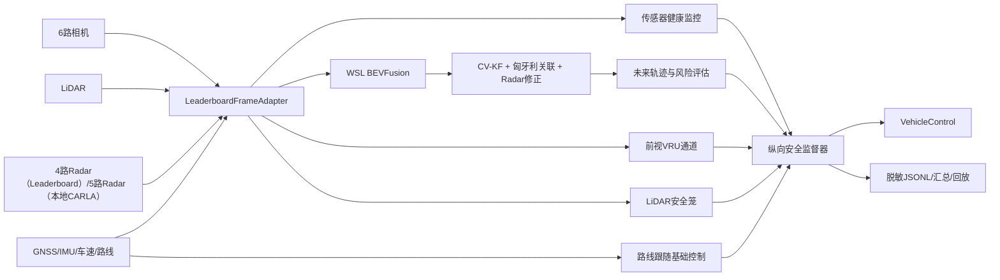

# Fusion Safety Agent 代码地图

本文只描述正式运行时文件。历史 Stage、训练脚本、消融实验和第三方仓库不属于产品
运行依赖。

## 1. 数据与控制关系

## 2. 产品入口与编排

| 文件 | 主要职责 | 关键实现位置 |
|---|---|---|
| `fusion_safety_agent.py` | Leaderboard 文件入口和命令行入口 | `get_entry_point`、`main` |
| `fusion_tracking_agent/__init__.py` | 稳定公共 API 导出 | `FusionSafetyLeaderboardAgent`、`FusionSafetyAgentConfig` |
| `fusion_tracking_agent/__main__.py` | 支持 `python -m fusion_tracking_agent` | `main` |
| `fusion_tracking_agent/cli.py` | `doctor/show-config/manual` 命令解析 | `_parser`、`main` |
| `fusion_tracking_agent/config.py` | 产品默认值、可移植路径和参数校验 | `FusionSafetyAgentConfig.from_json`、`validate` |
| `fusion_tracking_agent/leaderboard_agent.py` | Leaderboard 生命周期、逐帧入口和控制返回 | `FusionSafetyLeaderboardAgent.setup/run_step/destroy` |
| `fusion_tracking_agent/pipeline.py` | 感知、跟踪、风险、健康门控和纵向仲裁主链 | `FusionSafetyPipeline.__init__/step/close` |
| `fusion_tracking_agent/manual_runtime.py` | 组装六相机手动驾驶仪表盘 | `ManualRunOptions`、`run_manual` |
| `fusion_tracking_agent/route_controller.py` | 根据全局路线生成上游油门、制动和转向请求 | `RouteController.control` |

## 3. 输入、健康状态与输出

| 文件 | 主要职责 | 关键实现位置 |
|---|---|---|
| `fusion_tracking_agent/sensor_adapter.py` | 声明传感器并统一图像、点云、Radar、定位坐标 | `sensor_suite`、`LeaderboardFrameAdapter.convert` |
| `fusion_tracking_agent/sensor_health.py` | 检查缺帧、点数、帧差并进行故障/恢复去抖 | `OnlineSensorHealthMonitor.evaluate` |
| `fusion_tracking_agent/fault_plugins.py` | 仅供评测的可重复传感器故障注入 | `SensorFaultPlugin.apply` |
| `fusion_tracking_agent/telemetry.py` | 区分仿真时间、墙钟时间和后端推理时延 | `OnlineTimingTelemetry.observe_perception/observe_control/finalize` |
| `fusion_tracking_agent/output_contract.py` | 正式输出文件名与历史只读兼容 | `resolve_frame_log`、`resolve_summary` |
| `fusion_tracking_agent/privacy.py` | 在日志和交付证据写出前移除个人路径与主机名 | `sanitize_for_export` |
| `fusion_tracking_agent/replay.py` | 把结构化轨迹、风险和控制记录生成 BEV 回放 | `load_records`、`write_replay` |
| `fusion_tracking_agent/diagnostics.py` | 检查传感器契约、模型、证书、CARLA 与 WSL | `build_diagnostic_report` |

## 4. 补充安全通道

| 文件 | 主要职责 | 关键实现位置 |
|---|---|---|
| `fusion_tracking_agent/front_vru_safety.py` | 前视行人/骑行者快速检测、独立跟踪和横穿风险 | `FrontVRUSafetyMonitor.step` |
| `fusion_tracking_agent/lidar_safety_cage.py` | 从原始 LiDAR 搜索本车路径内障碍点簇 | `LidarPathSafetyCage.evaluate` |

## 5. BEVFusion 运行桥

| 文件 | 主要职责 | 关键实现位置 |
|---|---|---|
| `fusion_tracking_bevfusion/__init__.py` | BEVFusion 桥公共类型导出 | 模块导出列表 |
| `fusion_tracking_bevfusion/schema.py` | Windows 与 WSL 之间的稳定框和序列数据契约 | `BEVFusionBox`、`BEVFusionFrameResult` |
| `fusion_tracking_bevfusion/backend_mmdet3d.py` | WSL 内加载 MMDetection3D BEVFusion 并常驻推理 | `_load_backend_model`、`serve_carla` |
| `fusion_tracking_bevfusion/carla_online.py` | 图像/点云预处理、stdin 数据包和 latest-only 异步工作器 | `resolve_wsl_runtime`、`LatestOnlyBEVFusionWorker` |
| `fusion_tracking_bevfusion/adapter.py` | 把三维框转换为本项目 `FusionDetection` 并分配 Radar 证据 | `detections_from_bevfusion` |
| `fusion_tracking_bevfusion/active_carla.py` | 校验证书并保证只有合格 BEVFusion 结果进入主跟踪器 | `CertifiedBEVFusionActiveWorker` |
| `fusion_tracking_bevfusion/quality_gate.py` | 权重哈希和 Active 运行契约校验 | `validate_active_certificate` |

## 6. CARLA 在线算法组件

| 文件 | 主要职责 | 关键实现位置 |
|---|---|---|
| `fusion_tracking_carla/__init__.py` | CARLA 子系统公共类型导出 | 模块导出列表 |
| `fusion_tracking_carla/config.py` | 传感器、感知、跟踪、显示和本地会话配置 | `SensorConfig`、`PerceptionConfig`、`TrackerConfig` |
| `fusion_tracking_carla/types.py` | Radar、检测和轨迹快照的数据结构 | `RadarReturn`、`FusionDetection`、`TrackSnapshot` |
| `fusion_tracking_carla/geometry.py` | CARLA、内部右手系、相机投影和 ego/global 变换 | `transform_points`、`global_to_ego_xy` |
| `fusion_tracking_carla/perception.py` | 传统前端及前视 VRU 所需的检测、LiDAR 抬升和异步队列 | `PerceptionJob`、`LatestOnlyPerceptionWorker` |
| `fusion_tracking_carla/tracker.py` | CV-KF 生命周期、匈牙利匹配和 Radar 高频速度修正 | `StreamingFusionTracker.update/refine_snapshots_with_radar` |
| `fusion_tracking_carla/safety.py` | 把 global 轨迹变换为 ego 风险、TTC 和安全裕度 | `assess_tracks` |
| `fusion_tracking_carla/safety_supervisor.py` | 风险迟滞、数据新鲜度门控和纵向控制限制 | `RiskAwareLongitudinalSupervisor.evaluate/arbitrate` |
| `fusion_tracking_carla/autoware_aeb_shadow.py` | 路径碰撞与制动距离的旁路 AEB 对照 | `AutowareAEBShadowEvaluator.evaluate` |
| `fusion_tracking_carla/inference_arbiter.py` | BEVFusion 与 VRU 共用 GPU 时的优先级保护 | `PriorityInferenceArbiter.lease` |
| `fusion_tracking_carla/sensors.py` | 本地 CARLA 六相机、LiDAR、Radar 创建与同步 | `CarlaSensorRig.wait_for_frame` |
| `fusion_tracking_carla/session.py` | 本地世界、NPC、键盘、在线循环和视频输出 | `CarlaFusionSession.run` |
| `fusion_tracking_carla/dashboard.py` | 六相机、BEV、路线、风险和控制曲线绘制 | `Stage61Dashboard.render`（兼容类名） |
| `fusion_tracking_carla/runtime_launcher.py` | 无个人路径的 CARLA 自动发现、启动和解释器转接 | `_discover_carla_root`、`launch_server_and_wait` |
| `fusion_tracking_carla/evaluation.py` | 本地会话碰撞、路线、延迟和场景指标累计 | `ScenarioMetricsAccumulator` |
| `fusion_tracking_carla/oracle_evaluation.py` | 进程外只读真值评分；绝不进入在线控制输入 | `OracleTrackEvaluator` |

## 7. 与仿真器无关的融合核心

| 文件 | 主要职责 | 关键实现位置 |
|---|---|---|
| `fusion_tracking_core/__init__.py` | 核心算法公共 API | 模块导出列表 |
| `fusion_tracking_core/lidar_center.py` | 地面过滤、深度聚类和三维中心估计 | `estimate_lidar_observation` |
| `fusion_tracking_core/multicamera_fusion.py` | 多相机重复目标合并 | `fuse_multicamera_detections` |
| `fusion_tracking_core/radar_velocity.py` | Radar 异常值过滤和径向速度估计 | `estimate_radar_velocity` |
| `fusion_tracking_core/association.py` | 马氏距离/尺寸代价与匈牙利关联 | `associate_tracks` |
| `fusion_tracking_core/margin_safety.py` | 未来轨迹、不确定性、物理异常和安全裕度 | `predict_margin_safety`、`assess_kinematic_update` |

## 8. 调用原则

外部应用只应依赖 `fusion_safety_agent.py` 或 `fusion_tracking_agent` 的公共 API。其余三个
包是可替换的实现层。评测真值仅允许进入 `oracle_evaluation.py`，不能反向进入
`pipeline.py`、`tracker.py` 或 `safety_supervisor.py`。
